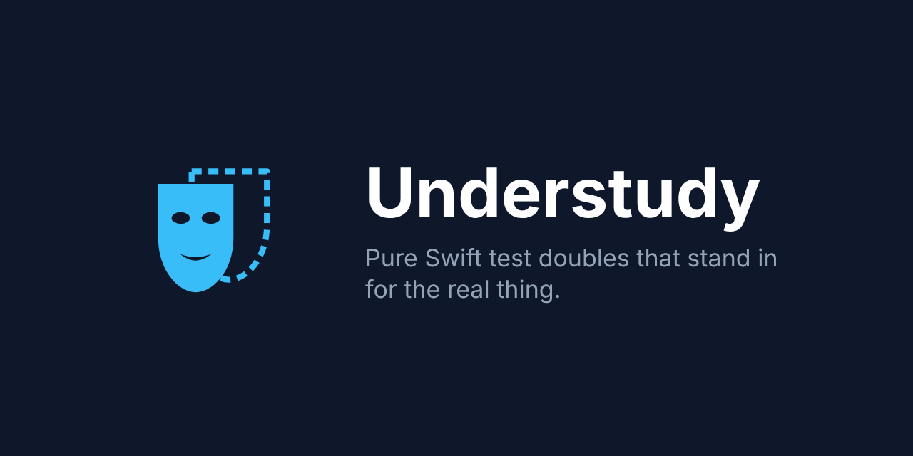

<p align="center">
  
</p>

# Understudy

Test doubles for Swift, written by Swift macros. Put `@Understudy` on a double in your test target and it writes a spy for every requirement: each call is kept, and each answer is scripted by the test. Stubs, spies, mocks and fakes, in a line per requirement, checked by the compiler against your protocol.

## Install

Add the package, and the product to your test targets:

```swift
dependencies: [
    .package(url: "https://github.com/joeoct-oss/Understudy", from: "0.3.0"),
],
targets: [
    .testTarget(
        name: "AppTests",
        dependencies: [
            "App",
            .product(name: "Understudy", package: "Understudy"),
        ]
    ),
]
```

## Example

Write the double in your test target. Mark each function `@Spied` and give it no body, and each property `@SpiedProperty` with a type and nothing else; the macro writes the code and a spy named after the requirement:

```swift
import Testing
import Understudy

@Understudy
final class SpyCatalog: Catalog {
    @SpiedProperty var region: String
    @Spied func product(id: Int) -> Product?
    @Spied func refresh() async throws
}

@Test
func showsTheProductItWasOpenedWith() {
    let catalog = SpyCatalog(region: "EG")
    catalog.productSpy.willReturn(.apple)

    let screen = ProductScreen(id: Product.apple.id, catalog: catalog)

    let expectedIDs = [Product.apple.id]
    #expect(screen.title == "Apple")
    #expect(catalog.productSpy.calls == expectedIDs)
}
```

Your shipped code doesn't change and never depends on Understudy. A function that returns something other than `Void` or an optional, and a property that isn't optional, needs its answer when the double is created, such as `SpyCatalog(region: "EG")`, so a double can't be called with nothing scripted. Overloads add their argument labels, such as `removeIdSpy` and `removeNamedSpy`. A property's spy keeps every value set, counts the gets, and answers with the last value set.

On a protocol you own, `@Understudy` writes the spy class next to it instead, such as `ClockSpy` for `Clock`, properties included. That protocol's target then depends on Understudy. A protocol that inherits another (other than `Sendable` or `AnyObject`) needs the class form, because the macro can't see the inherited requirements.

### Async calls

Hold an async call to check what the screen shows while it waits, then resume it with the answer you choose:

```swift
let refresh = catalog.refreshSpy.holdNextCall()
let task = Task { await screen.reload() }

await refresh.arrived()
#expect(screen.isLoading)
refresh.resume(returning: ())
await task.value
#expect(!screen.isLoading)
```

`resume(throwing:)` fails the call instead, and `resumeWithScriptedAnswer()` gives the answer the spy would have given. To wait for a call made from another task, use `await spy.nextCall()`, which gives each call once, in order, or `nil` when none comes within the time you give it (one second by default).

### Strict spies

A spy that is told what to expect reports, at `verify()`, every expected call that didn't happen and every call nobody expected:

```swift
analytics.trackSpy.expect("checkout")
analytics.trackSpy.expect(times: 2) { $0.hasPrefix("view") }
// ...
analytics.trackSpy.verify()
```

`expectNoCalls()` makes every call a problem. A spy with no expectations stays lenient. `verify()` records each problem as a Swift Testing issue at your test's line.

### Call order

To check the order of calls across spies, watch them with one `CallOrder`:

```swift
let order = CallOrder()
order.watch(store.saveSpy, as: "save")
order.watch(sync.sendSpy, as: "send")
// ...
#expect(order.names == ["save", "send"])
```

### Spies by hand

The macros write calls to `Spy`, `ThrowingSpy` and `PropertySpy`, which you can also use on their own, for a double the macros don't cover, such as one with subscripts or generic requirements:

```swift
final class SpyCatalog: Catalog {
    let productSpy = Spy<Int, Product?>(returning: nil)

    func product(id: Int) -> Product? {
        productSpy(id)
    }
}
```

`ThrowingSpy` does the same for requirements that throw. An async requirement calls `await productSpy.respond(to: id)` instead, so the test can hold the call. Both work with Swift 6 strict concurrency, from main-actor and `Sendable` test doubles alike.

## License

MIT. See [LICENSE](LICENSE).
